## `> neofetch`

## `> ls ./tech_stack`

`// web & mobile` 
  
`// backend & cloud` 
  
`// game dev & tools` 

## `> ./work --company "Tireda Technology"`

  

## `> ls ./games --unity`

  
  
  
  

## `> git log --stats`

  
    
  <picture>
    <source media="(prefers-color-scheme: dark)" srcset="https://raw.githubusercontent.com/Alpha-Espada/Alpha-Espada/output/github-snake-dark.svg" />
    
  </picture>

## `> ping alpha.espada`

<code>// EOF — thanks for stopping by_</code>

